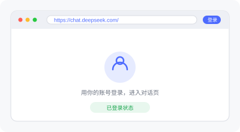
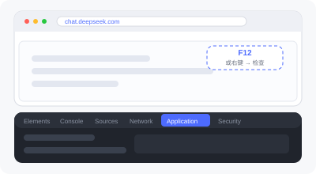
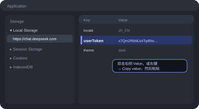
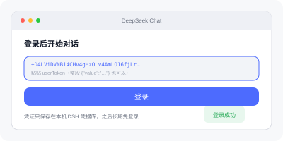
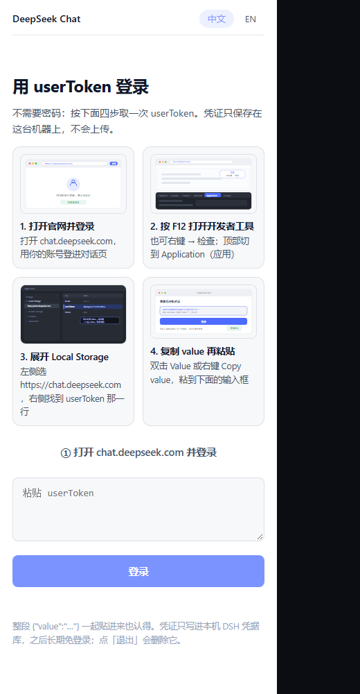
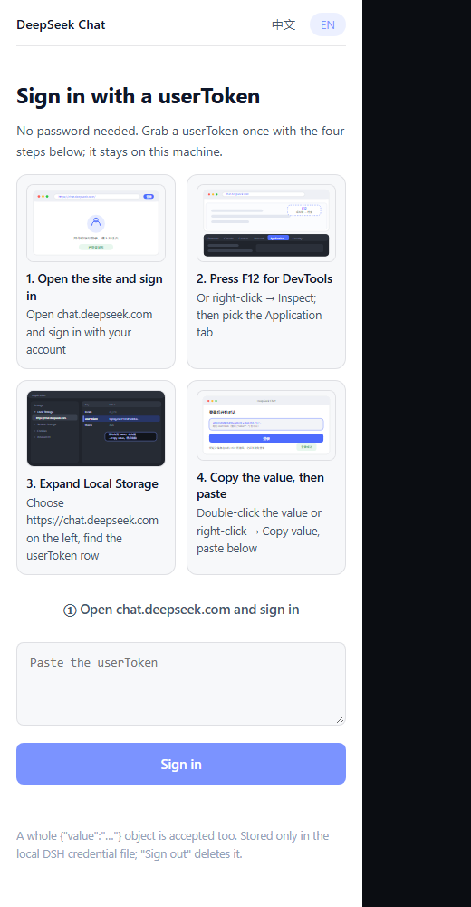
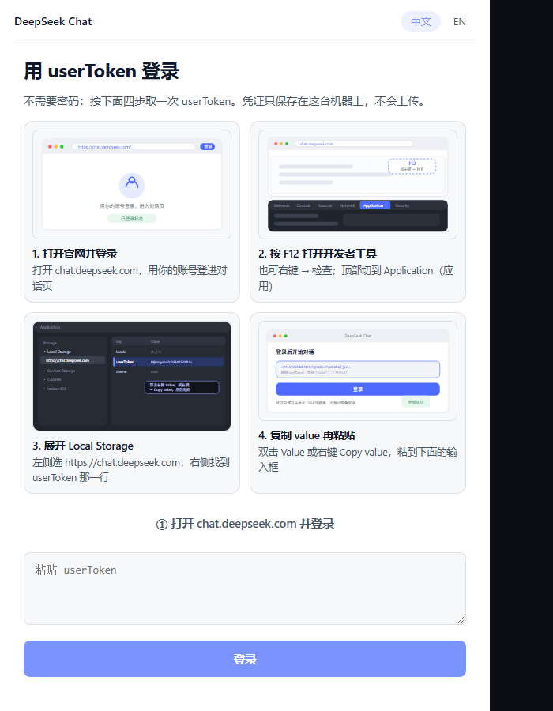
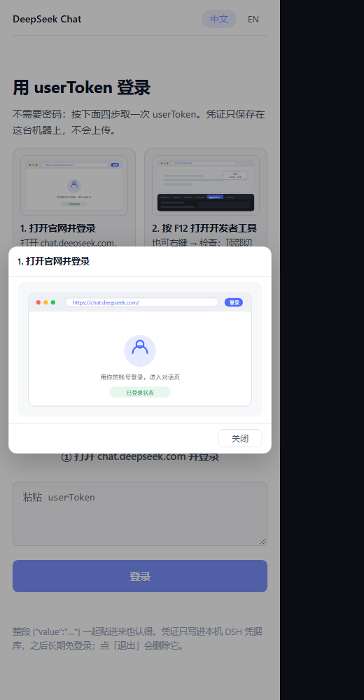
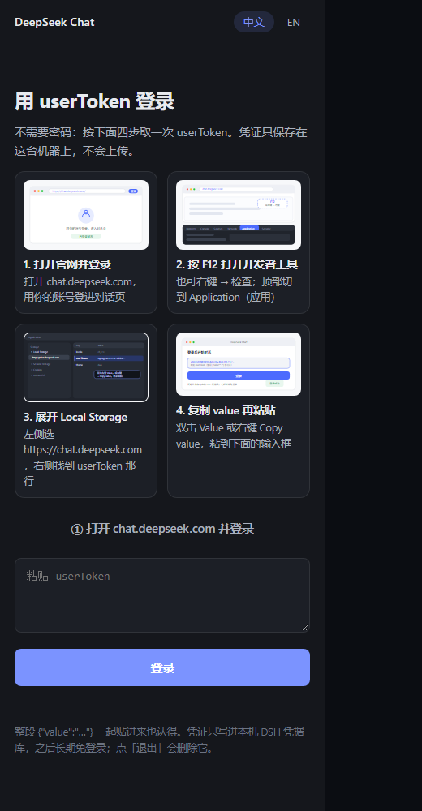

# 获取 userToken

中文 · [English](guide.en.md)

面板只接受一种凭证：`chat.deepseek.com` 的 **`userToken`**。它相当于"这台机器已登录"。
拿到一次、粘进面板一次，之后长期免登录。全程大约 30 秒。

> 为什么要手动取一次：DSH 与网页版虽然是同一个账号，但凭证体系不同 —— DSH 存的是 Platform
> 凭证，发给 `chat.deepseek.com` 会被拒绝（`40003 invalid token`）；微信扫码 / 短信 / Apple
> 的回调都落在 `chat.deepseek.com` 自己的域名上，第三方面板拿不到。所以第一次必须由人交接。

---

## 第 1 步 · 打开并登录官网



浏览器打开 <https://chat.deepseek.com/>，用你平时的方式登录（密码、短信验证码、微信扫码都行），
确认已经进到对话页面。

登录页上的「① 打开 chat.deepseek.com 并登录」按钮会直接帮你打开这一页。

---

## 第 2 步 · 按 F12 打开开发者工具



- Windows / Linux：`F12` 或 `Ctrl + Shift + I`
- macOS：`Cmd + Option + I`
- 也可以右键页面空白处 → **检查 / Inspect**

打开后，在顶部标签里选 **Application**（中文界面叫 **应用**）。

---

## 第 3 步 · 展开 Local Storage，找到 userToken



1. 左侧栏找到 **Storage → Local Storage**；
2. 展开后点击 `https://chat.deepseek.com`；
3. 右侧表格里找 **Key = `userToken`** 的那一行。

| 可能看到的 Key | 说明 |
|---|---|
| `userToken` | ✅ 就是要这个 |
| 值形如 `x7Qm2Rb9Lk4Tp8Nv…` | 一长串，可能带 `+` `/` `=` |

---

## 第 4 步 · 复制 value，粘贴到面板



- 双击那一行的 **Value** 单元格，`Ctrl + C`；
- 或者右键该行 → **Copy value**。

回到面板登录页，粘进输入框，点「登录」。

面板认得三种粘贴内容，随便哪种都行：

```text
x7Qm2Rb9Lk4Tp8Nv...
```
```json
{"value":"x7Qm2Rb9Lk4Tp8Nv...","__version":"0"}
```
```text
userToken: x7Qm2Rb9Lk4Tp8Nv...
```

登录成功后输入框自动清空，右下角出现版本号（如 `v0.6.2`），顶栏显示打码后的账号。

---

## 面板里的样子

登录页上的任意插图都可以**点开放大**（点背景或按 `Esc` 关闭）。

| 中文（400px 侧栏） | English |
|---|---|
|  |  |

宽一点的面板（620px）：



放大插图的弹窗：



深色主题：



## 常见问题

**提示「这个 userToken 无效或已过期」**
说明复制的不是 `chat.deepseek.com` 这一项，或者浏览器端已经退出登录。回到第 3 步重新复制；
若 `userToken` 那行不见了，先在网页端重新登录。

**提示「登录已过期，请重新登录」**
网页端拒绝了已存的凭证（40002/40003）。插件会**删除**本地凭证并退回登录页，按上面四步重做一次即可。

**换一台电脑 / 重装**
凭证存在本机 DSH 凭据库（`.credentials.yaml`，`kind: grant`），不跟账号同步，每台机器需要做一次。

**能不能不手动取**
不能。跨源读不到网页端的 `localStorage`，桌面外壳也没有给插件开放 `executeJavaScript` 或
cookie/storage 读取能力（只有 `acquire / release / onOpenRequested`）。`v0.5.0` 里的账号密码登录
是刻意移除的。
